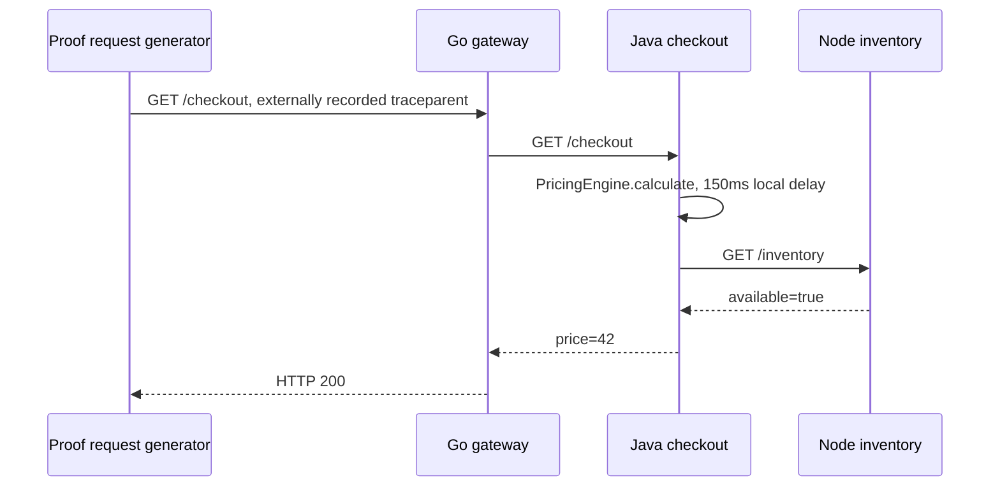

# Executable coexistence demo specification

Historical research/proof reference. For the current 18-service, two-second
retired-endpoint presentation, use the [live run sheet](../demo/README.md#live-run-sheet)
and [current customer resolution](customer-resolution.md). The earlier sleep,
router and candidate versions below describe their original experiment.

Version: 2026-10-06. This specification implements the first proof gate from
[technical findings](technical-findings.md). Results belong in the accompanying
proof report; expected behavior here is not a claim that the experiment passed.

## The audience's question

Can a platform add application-method detail to one service, keep broad request
observability across the system, and remove that depth again without changing
application source or rebuilding its image?

The first proof must answer this before we package a general Operator extension,
claim universal coverage, or quantify cost savings.

## Workload and incident



All application hops use plaintext HTTP/1.1. The managed checkout Service now
points to a proof router, which forwards to a telemetry-verified checkout Pod IP.
This extra infrastructure hop provides explicit per-request handoff and drain;
it preserves headers, has no telemetry dependencies, and creates no spans.
Application code contains no OpenTelemetry API, SDK, agent, annotations, or manual
propagation. The external generator supplies a unique W3C trace context solely
to identify each request in the raw evidence. Its unexported parent span is an
explicit boundary, not an unexplained missing application span.

Checkout uses JDK 21's built-in HttpServer and synchronous HttpURLConnection.
The earlier java.net.http.HttpClient fixture is preserved with its failing
trace evidence; changing the fixture does not establish that client's correctness. The pricing
method sleeps for 150ms and performs no network I/O. This exposes method duration,
not arbitrary method arguments or inferred business attributes.

## Frozen building blocks

| Component | Artifact |
| --- | --- |
| OBI library | v0.14.0 release-generated source, verified against a frozen SHA-256. |
| Operator | v0.160.0, official Helm chart 0.124.1, generated webhook certificates. |
| Java agent | Operator injection image 2.30.0; bundled SDK 1.64.0. |
| Collector | Contrib 0.160.0, OTLP HTTP receiver and unfiltered JSON file exporter. |
| kind node | Kubernetes v1.33.2 on the Linux host's actual kernel. |
| Application bases | Go 1.26.8, Node 24/bookworm, JDK 21 from Gradle 8.14.4 image. |

Tags identify build inputs; the capture records running image IDs. Before
publishing the attendee kit, freeze all base and remote image digests as well.
This first experiment's captured image IDs establish what actually ran, not an
already portable digest lock for every dependency.

## Instrumentation policy and ownership

The experiment's central policy runner is `demo/proof/scripts/proof.sh`. It uses
the standard Operator's Instrumentation resource and pod-template annotation.
The small proof agent embeds OBI's dynamic selector and reconciles enrolled
processes every 200ms. This is a deliberately scoped experiment, not a finished
CRD, multi-tenant controller, or automatic language-detection extension.

Each application has explicit `PROOF_NAMESPACE`, `PROOF_SERVICE`, and pod-name
metadata. The agent scans only the marked gateway/checkout/inventory processes.
It records PID, process start time, pod, and service. PID reuse or a changed
process identity removes prior selector membership before assigning new
membership. No static workload trace selection is unioned with those PID views.

| Effective state | Gateway traces | Checkout traces | Inventory traces | RED metrics |
| --- | --- | --- | --- | --- |
| Breadth | OBI | OBI | OBI | OBI for all three services |
| Depth | OBI | Java SDK | OBI | OBI for all three services |
| Return to breadth | OBI | OBI | OBI | OBI for all three services |

OBI header propagation is explicitly enabled. Automatic SDK avoidance is
disabled for this enrolled experiment. SDK metrics and logs exporters are
disabled. Checkout's agent presence is observed from the actual process's
injected `JAVA_TOOL_OPTIONS`, not from the desired Deployment annotation.
The method configuration is:

```text
OTEL_INSTRUMENTATION_METHODS_INCLUDE=demo.checkout.PricingEngine[calculate]
```

For adding depth, the runner annotates checkout with `checkout-depth`; the
Deployment creates a replacement pod, which the Operator mutates at admission.
During overlap, the old process retains OBI traces and the new process has SDK
traces. For removal, the runner sets injection to `false`, causing another rollout.
The application image stays identical throughout. The TCP readiness probe only
checks application startup. A custom readiness gate keeps the old pod alive while
`handoff.py` verifies the candidate's exported checkout and inventory trace chain,
trace ownership, configured method span, and current OBI metrics.

The runner switches the proof router to the candidate, waits for old requests to
finish and export their spans and a fresh metric sample, then releases the
candidate's Kubernetes readiness gate. The Deployment can retire the old pod only
after this sequence. Failure before routing retains the old route; failure during
export drain restores it and leaves both pods alive. See the
[reliability report](reliability-results.md) for the implemented control path and
its scope. This mechanism belongs to the custom proof integration.

## Reproduction commands

Requirements: Docker access; kind; Helm; kubectl; Bash; ripgrep; Python 3.12+;
network access to release/image registries; a Linux host supporting OBI's selected
eBPF features. This creates only the dedicated `far-wide-proof` cluster and uses
its private kubeconfig. It does not operate on the user's current context.
The privileged proof agent is restricted by its process enrollment policy.

From the repository root:

```bash
# Build uninstrumented application images and the OBI embedding; install Operator.
demo/proof/scripts/proof.sh prepare

# Install the Collector, applications, profile, and OBI agent in breadth state.
demo/proof/scripts/proof.sh up

# Capture independent steady-state requests with their raw telemetry.
python3 demo/proof/scripts/capture.py initial-breadth --mode breadth

# Load continues while the actual Deployment and Operator perform the rollout.
python3 demo/proof/scripts/capture.py to-depth --mode transition --transition depth --count 80 --concurrency 1

python3 demo/proof/scripts/capture.py sdk-depth --mode depth

python3 demo/proof/scripts/capture.py to-breadth --mode transition --transition breadth --count 80 --concurrency 1

python3 demo/proof/scripts/capture.py restored-breadth --mode breadth

demo/proof/scripts/proof.sh status
```

The capture waits 20 seconds after traffic for OBI's HTTP finalization fallback
(10 seconds of inactivity, polled every two seconds) and the export/file batches.
This is collection latency, not a request-latency promise. See the
[released finalization implementation](https://github.com/open-telemetry/opentelemetry-ebpf-instrumentation/blob/13d9b0c3f600a060bd78820a63ebec882b10757e/pkg/internal/ebpf/generictracer/generictracer.go#L1000-L1050).
The capture creates a new evidence directory for every invocation and exits
nonzero if an assertion fails. It starts private, dynamically allocated loopback
port forwards and stops only those subprocesses when done. A failed stage
retains the cluster and evidence for inspection. Do not skip failures with
`|| true` and subsequently describe the complete experiment as passing.

To re-evaluate an existing capture without another deployment:

```bash
python3 demo/proof/scripts/replay.py PATH_TO_CAPTURE
```

The replay reads the recorded mode, verifies snapshot integrity, and checks traces,
metrics and rollout ordering without replacing the original report. When done
inspecting the isolated cluster:

```bash
demo/proof/scripts/proof.sh down
```

## Exact trace assertions

For every recorded request, require one span for each application request role:

1. gateway SERVER, parented to the recorded external parent span ID;
2. gateway CLIENT, parented to gateway SERVER, possibly through OBI's `processing` span;
3. checkout SERVER, parented to gateway CLIENT;
4. checkout CLIENT, parented to checkout SERVER, possibly through OBI's `processing` span;
5. inventory SERVER, parented to checkout CLIENT.

All five must share the generator's trace ID. A client and server span for one
hop are expected; two spans for the same service/request role are duplicates.
HTTP 200 is required. Missing exported spans and wrong parents fail even when
application requests succeed.

Intermediate `processing` spans are allowed only when exported by OBI in the same
service and connected to the expected server span. Missing intermediate parents,
cycles, and arbitrary ancestry are failures. This reflects the structure observed
in the first raw capture; a mistaken direct-parent-only check was corrected.

Depth additionally requires exactly one `PricingEngine.calculate` INTERNAL span,
parented to checkout SERVER and lasting at least 100ms. In breadth that span
must be absent. Identify OBI through its distro identity and `go.opentelemetry.io/obi`
scope, including this release's resource-level `otel.scope.name`. Identify Java
request ownership through its agent distro identity and instrumentation scopes.
Do not infer ownership merely from service names.

Transition captures record at least five requests before invoking the rollout.
The final reliability rehearsal sends one measured request every 0.4 seconds.
Its source and application images remain fixed across profile changes. Four-caller
trials failed with both Java clients; the original HttpClient fixture also failed
a serial trial. Those captures remain counterexamples to broader compatibility
and load claims.
Traffic continues throughout the handoff and for at least twenty requests after
it finishes. Each successful transition must observe both breadth and depth.
Every request is subject to the same continuity and duplicate checks; checkout's
observed owner determines whether the method span is required. Every measured request remains in the denominator. Candidate admission probes
run before that pod receives user traffic; their IDs, statuses, and admission
errors are separately retained in the handoff journal, and their telemetry stays
in the unfiltered raw output. Startup probe failures cannot admit a pod.

## Metric and rollout assertions

Require in-window, positive-count HTTP server duration histograms for every
service from OBI's scope. Require status-code attributes so successful-request
counts can be used for rate and error-rate calculations. For transitions, inspect
fresh observations across the entire window. The reliability verifier records
pre-traffic counts and each candidate's pre-routing count. Every pod must show a
count increase covering all measured requests it served. Repeated exports of one
cumulative count are not summed as new requests. Extra inventory counts from
admission probes are allowed and reported separately from measured requests.

The capture records pod and Deployment JSON before/after, Instrumentation JSON,
process ownership over time, agent logs, Collector logs, checkout logs, and
application-source hashes. Compare checkout pod UIDs and application image IDs
to establish replacement with the same image. Require the injected init container
and Java startup version in depth, and their absence on the restored breadth pod.
The Go and Node application pods must not be rolled as a side effect.

## Evidence and failure behavior

Each capture directory under `demo/proof/.artifacts/runs/` contains:

- `requests.jsonl`: every request's trace context, timestamps, status, and latency;
- `telemetry.jsonl`: unmodified Collector file output, including failed traces;
- `ownership.jsonl`: process identities and trace owners sampled during requests;
- Kubernetes snapshots and logs: actual admitted pods, images, and profile;
- `capture.json`: configuration metadata, source hashes, raw telemetry hash;
- `report.json`: machine-readable assertions and all request failures;
- `handoff.json` and router snapshots: admission, routing, drain, and commit;
- `metric-count-report.json`: per-pod measured requests and OBI count increases;
- `snapshot.json` and `telemetry-pending-tail.bin`: frozen-byte snapshot metadata
  and any incomplete append, preserved separately from complete JSON records.

Preserve a compressed copy of each full capture and its SHA-256 in the durable
proof report. Failed evidence is as important as passing evidence. The experiment
can establish this particular topology and pin set only. It cannot establish
TLS, meshes, gRPC, arbitrary frameworks, production traffic volume, or every SDK
language. Any passing claim is bounded to the recorded synchronous Java fixture,
load and runtime. Concurrent correctness and the original HttpClient compatibility failure remain open.

If a gate fails, retain and minimize the counterexample, identify whether it is
capture, propagation, duplication, signal ownership, or admission/rollout, and
correct the mechanism. Any revised experiment gets a new capture; an earlier
failure remains in the report.

## Subsequent work after the coexistence gate

The next implementation replaces this tightly scoped runner with the central
policy controller, adds persistent routing and reconciliation after controller
or router restart, then
tests Java agent 2.30.0 → 2.31.1 and rollback with observed SDK versions. Finally
measure uninstrumented, breadth, depth, and restored breadth states under equal
load. Do not use this continuity experiment as a CPU, byte-volume, or dollar-savings
benchmark. Those later gates remain separately required by the talk brief.

## Candidate Injector migration — 2026-10-19

The [Injector prototype evaluation](technical-findings.md#injector-prototype-evaluation--2026-10-19)
identifies the Grafana forks, frozen source revisions, harness changes and
promotion gates for an alternative SDK-injection backend. The candidate
[policy](../demo/injector/checkout-policy.yaml) and
[cluster configuration](../demo/injector/kind.yaml) are schema/configuration
review inputs, not part of this executable proof. The existing results apply
only to the released Operator described above. Evaluate the prototype in its
own cluster and adapt ownership discovery, admission, rollout assertions and
capture before making new coexistence or reliability claims.
