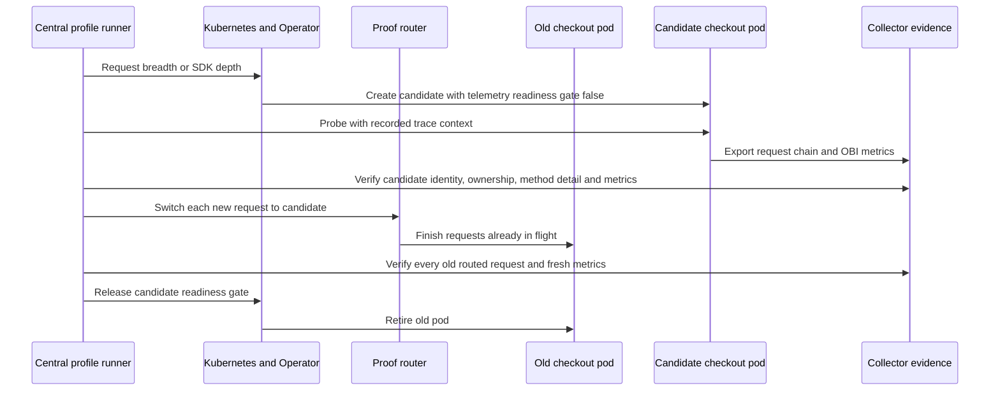

# Instrumentation handoff reliability

The final fresh-cluster rehearsal passed **1,086/1,086 measured requests** across
three SDK add/remove round trips, a rejected candidate, recovery, and final
removal: eight committed profile changes. This is a passing **serial-load demo
using synchronous HttpURLConnection**. Four-caller tests remain failed gates,
and the original java.net.http.HttpClient fixture also failed at serial load.

The revised coexistence demo admits a replacement checkout pod only after its
telemetry arrives, then keeps the old process alive until its requests and
exported observations drain. The application sources and images stay unchanged
across instrumentation profiles.
During preparation, the Java fixture was changed from java.net.http.HttpClient to
synchronous HttpURLConnection after the original client failed repeated trials.
That compatibility failure remains open; the earlier source and traces are preserved.
This control path is a custom integration around the released OBI library and
OpenTelemetry Operator.

## Final measured rehearsal

Executed on 2026-10-06 with the documented default command, including image
builds, fresh kind creation and a first-revision Operator install. All ten
captures independently replayed offline and match the final harness source
hashes. Every stage passed trace identity/parent/owner checks, OBI request-count
accounting and its applicable Kubernetes/routing assertions.

| Stage | Complete traces / measured requests | Requests with SDK method detail |
| --- | ---: | ---: |
| Initial breadth | 40/40 | 0 |
| Add SDK 1 | 147/147 | 51 |
| Remove SDK 1 | 116/116 | 73 |
| Add SDK 2 | 131/131 | 51 |
| Remove SDK 2 | 115/115 | 71 |
| Add SDK 3 | 129/129 | 50 |
| Remove SDK 3 | 113/113 | 70 |
| Reject candidate; keep breadth | 96/96 | 0 |
| Recover into SDK depth | 83/83 | 51 |
| Final removal | 116/116 | 74 |

The 491 SDK-owned measured requests each contain one correlated method span.
Transition rows include both the old and new instrumentation profiles. All
requests returned HTTP 200; no measured requests were retried or discarded.
Startup admission probes have separately recorded IDs and outcomes. The rejected
candidate never received routed traffic; the recovery promoted that same pending
candidate. All captures retained identical application image IDs, and gateway
and inventory pod UIDs remained unchanged throughout.

[Machine-readable results](evidence/reliability-2026-10-06/summary.json),
[full capture index](evidence/reliability-2026-10-06/index.json), and
[offline replay results](evidence/reliability-2026-10-06/offline-replay.json)
provide the per-stage evidence. A
[representative SDK trace](evidence/reliability-2026-10-06/trace-examples.json)
shows `PricingEngine.calculate` lasting 150.23ms with SDK 1.64.0; the initial and
restored breadth examples have no such span. These are derived inspection aids,
with exact raw line references; complete unfiltered telemetry remains archived.

The [evidence README](evidence/reliability-2026-10-06/README.md) explains archive
extraction, offline replay and SHA-256 verification. It preserves earlier failed
and interrupted trials as well as this final run. Local validation also passed
21 Python tests, two router tests with Go race detection, Bash syntax validation
and ShellCheck.

The dedicated cluster is left ready in breadth state for inspection. The user's
default Kubernetes context remains `kind-test-kind-cluster-otel-python`.
The retained profile and readiness are recorded in
[the final state](evidence/reliability-2026-10-06/final-state.json), with
[a full pod snapshot](evidence/reliability-2026-10-06/final-pods.json).
The final capture archive includes the router route and request ledger.

## Admission and retirement



Kubernetes supports additional [pod readiness conditions](https://kubernetes.io/docs/concepts/workloads/pods/pod-lifecycle/#pod-readiness-gate).
The custom condition in this experiment holds the Deployment's retirement step.
Traffic promotion is explicitly controlled by the router, which forwards to a
verified Pod IP before that condition is released. The checkout Service points
to this router. This routing layer is an additional deployment requirement;
the upstream Operator does not provide this coordinated handoff by itself.

The router preserves existing HTTP trace context and creates no spans. It uses
a separate upstream connection per request, chooses the destination under a lock,
and records destination, trace context, response status and active request count.
After a switch, requests arriving on an existing gateway connection also use the
new destination. An old in-flight request retains its original destination.
The applications contain no tracing dependencies or manual header forwarding.

Candidate admission requires a complete checkout SERVER → CLIENT → inventory
SERVER parent chain, exactly the configured method detail, the correct checkout
trace producer, the candidate's pod identity, and a current OBI HTTP-200 server
histogram. Merely discovering a PID or seeing `-javaagent` cannot satisfy it.
Before retirement, every request in the old route's ledger must have its expected
chain in the Collector, and the old pod must have exported a metric sample after
its last request completed. SDK trace ownership and OBI metrics remain separate
throughout overlap.

Failures before promotion leave the existing route intact. An export-drain
failure after promotion restores that route and leaves both processes alive.
The readiness gate is the commit point; the runner does not claim it can restore
a pod after Kubernetes has begun retiring it. A host lock and compare-and-set
route updates reject competing local profile changes.

## Preserved compatibility failures

The original Java fixture used JDK 21's java.net.http.HttpClient.send. The application
made blocking calls; the reference JDK implementation delegates them to its internal
asynchronous machinery, a distinction to investigate rather than an established
cause. With four simultaneous callers, the first coordinated add/remove pair passed 520/520 and
408/408 requests. A repeated add-depth test then failed four of 1,000 requests:
two duplicated a checkout CLIENT span ID, while two simultaneous requests lacked
that role. The export-drain gate refused retirement.

A fresh-cluster experiment enabled OBI's supported
`ebpf.high_request_volume: true` setting. That repeat failed five of 1,000
requests, with wrong parents, duplicated server observations and missing roles.
The runner restored the old route and retained the old pod. Immediate HTTP
completion did not resolve the failure; the final harness uses the default
completion setting. No upstream code was patched.

Reducing load to one caller also failed: adding SDK depth passed 109/109 requests,
but removal produced complete traces for only 132/146. Every request returned
HTTP 200, and metric accounting and rollout ordering passed. Fourteen outbound
checkout requests and their inventory server spans appeared under an earlier
trace from a retired checkout JVM, rather than their recorded external trace IDs.
One example is documented in [the compatibility counterexample](compatibility-counterexample.md).
This establishes that readiness and successful responses alone cannot prove
continued trace correctness. It does not establish the kernel/library root cause.

The revised fixture uses synchronous HttpURLConnection without telemetry APIs or
manual context forwarding. Its four-caller trial passed five consecutive changes,
then failed on the sixth: 378/380 complete traces, with one duplicated checkout
CLIENT span ID and one missing checkout CLIENT role. All requests returned HTTP
200; rollout ordering and metric accounting passed. This fixture change therefore
did not resolve concurrent correctness. Its image is frozen before the rehearsal
and identical in breadth and SDK depth. This selects a different compatibility case; it does
not fix or validate the original asynchronous implementation. The router does not
serialize requests, and the generator does not retry failed requests.

## Evidence checks

Each measured request must return HTTP 200 and have exactly one of the five
expected application SERVER/CLIENT roles, with the recorded external trace ID,
valid parent chain and correct producer. SDK-owned checkout requests must include
one correlated `PricingEngine.calculate` span exposing the 150ms delay. Breadth
requests must contain no such span. Duplicate IDs, missing observations and
failed responses fail the run.

The metric verifier records pre-traffic counts and each candidate's pre-routing
count. It requires cumulative OBI HTTP-200 count increases sufficient to cover
every measured request served by each pod, including both checkout generations.
Repeated exports are not added as new measurements. Admission probes can add
inventory observations; those extra counts are reported. These assertions
establish request accounting, not a guarantee about every export interval.

The final rehearsal sends one measured request every 0.4 seconds.
Traffic continues while the candidate starts, warms, promotes and drains, and for at least twenty requests
after the handoff completes. Candidate probes are separately identified in the
journal before that pod receives user traffic. Every measured request stays in
the denominator; all probes and measured traces stay in the raw output.

The evidence sidecar freezes a byte prefix of the append-only Collector file.
Complete JSON records and any unfinished tail are saved separately with lengths
and a hash of their concatenation. A complete malformed record remains an error;
a missing measured trace cannot be hidden by this snapshot boundary. Original
[rolling handoff failures](proof-results.md) remain preserved.

## Reproduction and scope

Run the fresh-cluster gate:

```bash
python3 demo/proof/scripts/rehearse.py
```

It prepares the dedicated `far-wide-proof` kind cluster, checks steady breadth,
runs three add/remove cycles at serial load, rejects a candidate
before routing, retries that desired profile, and returns to breadth. Each capture
and handoff journal is retained under `demo/proof/.artifacts/`. The command exits nonzero on any failed
assertion and retains the cluster for inspection. Cleanup is explicit:

```bash
demo/proof/scripts/proof.sh down
```

The proof covers planned profile changes in this Go → Java → Node.js plaintext
HTTP/1.1 fixture using synchronous HttpURLConnection, with OBI v0.14.0,
Operator 0.160.0 and Java agent 2.30.0.
The router and runner are scoped experiment components. Their single-process
routing state is not persistent or highly available. Router/controller restarts,
node failures, concurrent correctness, broader Java client compatibility, TLS,
service meshes, other SDK languages, upgrades to agent 2.31.1,
and resource-cost measurements are separate gates for the final talk deliverable.
