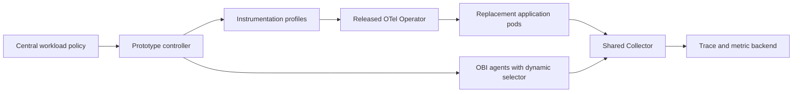

# OpenTelemetry Far and Wide: technical findings

Research date: 2026-10-05. This answers the preparation questions and records
the decisions that will shape the demo specification. It is a source review,
not a report of a working deployment. No cluster experiment, performance
measurement, image pull, or upstream test execution was performed in this review.

Follow-up on 2026-10-06: the [executable specification](demo-spec.md) and
[runtime proof report](proof-results.md) now exist. The experiment demonstrates
the three steady states and exposes rollout continuity failures. The source
review below records the initial research and proposed design. The
[reliability follow-up](reliability-results.md) adds telemetry admission, controlled
routing, export drain and repeated transition checks.

Follow-up on 2026-10-19: the [Injector prototype evaluation](#injector-prototype-evaluation--2026-10-19)
identifies the Grafana hackathon branches, evaluates migration requirements and
adds candidate configurations. Its source/local checks are separate from the
runtime results above.

## What can we confidently build the talk around?

The released projects contain the essential building blocks: OpenTelemetry eBPF
Instrumentation (OBI) supplies broad
request telemetry and runtime signal selectors; the Operator injects language
agents into new pods; the Java agent can instrument a named application method
through configuration. Combining those into a central policy with safe ownership
changes, rollouts, upgrades, and rollback is the proposed talk extension. That
complete integration has not been established by this research.

At the time of this review, the repository contained the talk brief and a title
slide, with no demo or extension implementation. Upstream has more integration than an older reading
of its issues might suggest: the Operator already documents deploying OBI through
a Collector receiver. That does not establish the policy-driven orchestration
promised by this talk. [Operator OBI deployment][operator-obi]

| Preparation question | Working answer |
| --- | --- |
| Who and how long? | Any-level Observability Day audience; a published 25-minute slot. |
| What does “fully instrumented” mean here? | Request traces and rate/error/duration metrics for every service in the defined demonstration, plus selected application-method spans. |
| Which workload? | Go gateway → Java checkout → Node.js inventory, using direct plaintext HTTP/1.1. |
| What debugging problem? | A slow local Java pricing calculation, with no network operation inside the method. |
| Where does depth come from? | A Java agent profile selecting the existing method by class and method name. |
| What central mechanism? | A prototype policy controller using the released Operator and an OBI agent embedding the dynamic selector API. |
| How do versions change? | Change the centrally owned agent profile and roll the selected workload to new pods. |
| How does cost change? | Remove SDK depth through a rollout; separately demonstrate live OBI signal selection. Measure their effects at the relevant layers. |
| What is the largest uncertainty? | Trace-context continuity and telemetry ownership during coexistence and rolling transitions. |

## What is the actual slot and audience?

The official schedule lists this talk at **10:40–11:05**, labels it **Any Level**,
and places it in **Observability Cost + Quality + Scale + Efficiency**. That is
25 minutes, not a presumed 35- or 40-minute conference slot. [Official schedule][schedule]

The [current storyboard](talk-storyboard.md) plans 21 minutes of content, one
minute of recovery time, and three minutes of questions. This allocation is
our choice, not an event requirement.
The attendee should leave able to choose an instrumentation profile and understand
the operational consequences. Kernel implementation details belong in the
companion material unless needed to explain an observed limitation.

## Which versions should the first proof use?

Freeze the following release candidates for reproducibility. These are research
pins, not a tested compatibility matrix. Resolve container image digests and
verify artifact availability when building the experiment.

| Component | Release | Immutable source commit | Reason |
| --- | --- | --- | --- |
| OBI | v0.14.0 | `13d9b0c3f600a060bd78820a63ebec882b10757e` | Released runtime selector and workload-selection implementation inspected here. |
| Operator | v0.160.0 | `c7cc68b4b4b8e7450315fa22da1a1f23a7664fad` | Released injection and Collector management implementation. |
| Java agent, initial | v2.30.0 | `080c1d32ca676ba7b0210c21b60cce8e7ac39058` | Bundles OpenTelemetry Java SDK 1.64.0. |
| Java agent, upgraded | v2.31.1 | `8ad06a082e051f366f19c16ad95a7b68edf30afd` | Bundles SDK 1.65.0; also the Operator release's default Java agent version. |

The SDK versions are declared in the agents' dependency-management files:
[initial SDK declaration][java-old-sdk] and [target SDK declaration][java-new-sdk].
The [Operator version manifest][operator-versions] confirms its Java default.
An agent's 2.x release number and its bundled SDK's 1.x release number describe
different artifacts; the demo must show both correctly.

The [source lock](evidence/source-lock.json) records release metadata, full
commits, retrieval URLs, and SHA-256 hashes of inspected files. It also records
which supplementary tests were read from development commits rather than a
release. A test's presence is evidence of intended behavior, not evidence that
we ran it or that our combined deployment passes it.

## What breadth can OBI promise, and what are the prerequisites?

For this talk, promise coverage of the selected services' supported request
operations and RED metrics. Do not expand “everything” to arbitrary business
semantics, every protocol, logs, profiles, every OS, or every network topology.
OBI's support matrix explicitly separates capabilities and limitations.
[Release support matrix][obi-support]

The first demonstration should use supported Linux nodes with BTF, a compatible
architecture and kernel, host process visibility, Kubernetes metadata access,
and the privileges required by the selected eBPF features. The general documented
kernel baseline is Linux 5.8+, with specific RHEL backport exceptions. The Operator
OBI deployment example requires a DaemonSet, `hostPID: true`, and elevated
privileges. Host compatibility and actual container permissions remain to be
tested. [Support requirements][obi-support] [Deployment requirements][operator-obi]

Choose direct plaintext HTTP/1.1 to make the trace-continuity question tractable.
Explicitly enable OBI header propagation: its architecture document lists
context propagation as disabled by default. Do not enable TCP-option propagation
as an unexplained fallback. Generic TLS, HTTP/2, gRPC, and proxies have additional
limitations; successful HTTP/1.1 evidence will not establish those paths.
[Propagation configuration][obi-propagation] [Protocol limits][obi-support]

“One command” will mean one invocation installing the instrumentation stack and
its central policy into a prepared cluster containing uninstrumented applications.
The later specification must inventory cluster setup and backend setup separately,
and state whether the command installs the Operator and its admission dependencies
or assumes they are present. It must not hide application instrumentation in the
preparation step.

## Which debugging incident best proves the value of SDK depth?

Use a slow synchronous method in Java checkout, tentatively
`demo.checkout.PricingEngine.calculate`, that performs local computation and
makes no network request. OBI should identify checkout as the slow service; the
selected method span should identify where time is spent inside that request.
This class and fault are design choices; they do not exist in this repository yet.

Use a bounded, repeatable delay for the narrative experiment. Keep the same fault
and request mix across instrumentation states. Do not use a database call as the
sole proof of SDK-exclusive depth: OBI already supports several database
protocols. Nor should we say eBPF cannot ever expose language-level detail; OBI
has runtime-specific capabilities too. The claim is that the selected SDK profile
adds this named application-method observation. [OBI capabilities][obi-support]

The Java agent supports configuration-only method instrumentation:

```text
OTEL_INSTRUMENTATION_METHODS_INCLUDE=demo.checkout.PricingEngine[calculate]
```

This is a proposed profile setting, not a command for an existing demo. The
[official Java documentation][java-method-doc] describes capturing method spans
without changing code. The released [configuration implementation][java-method-config]
maps selected methods to internal spans. Its [upstream test][java-method-test]
asserts a named internal span around an ordinary method that has no telemetry
annotation or API call; its [test agent configuration][java-method-test-config]
shows how that method was selected. The [advice implementation][java-method-advice] parents
the span using the current context.

Build the application image without an OpenTelemetry SDK, agent, annotations,
or manual trace-context forwarding. Record its source and image digest before
and after every instrumentation operation. The proof must show the method span
inside the same end-to-end request, not as a separate unparented trace. Configured
method selection still requires knowing the class and method; it is not automatic
discovery of arbitrary business meaning.

## What architecture satisfies the single-mechanism promise?

Use a small **prototype extension** with centrally declared workload/container
profiles. It should own `v1alpha1` Instrumentation resources, use the standard
Operator for SDK injection, and control node agents embedding the pinned OBI
library through its dynamic selector. Both telemetry paths export through the
same Collector to the demonstration backend.



This is a proposed architecture. The runtime selector exists in the released
OBI library, with independent trace and application-metric views and support for
Kubernetes workload references. The provided HTTP control server is an **example
embedding**, not evidence of a standard REST API on every OBI installation.
[Selector API][obi-selector] [Workload API][obi-workload] [Embedding example][obi-example]

The released Operator can also deploy the OBI Collector receiver. That is a useful
existing alternative for static deployment. This first design uses a separately
pinned embedded OBI agent because its runtime selection interface is the mechanism
we inspected; a Collector's version alone does not establish its bundled OBI
version or expose that interface. [Operator receiver example][operator-obi]

`ClusterObservability` already coordinates agent/cluster Collectors and an
Instrumentation resource, but its documentation still asks applications to
reference that resource through injection annotations. It does not establish
automatic language detection or enrollment of every existing workload.
[ClusterObservability behavior][cluster-observability]

Do not edit a generated ClusterObservability Instrumentation resource as though
the edit were a durable policy: the renderer derives its profile from Operator
configuration. Either extend that owning controller's configuration model or
give this prototype its own profiles. Choose the latter for the first proof.
[Generated profile implementation][cluster-profile]

## How can developers avoid application and manifest edits?

Central policy declares the selected workload, container, language, profile, and
version. The prototype reconciles the live pod-template injection annotation
and a rollout revision. Developers need not edit their application source,
image, or checked-in deployment files. Live Kubernetes resources **do** change.

The standard Operator selects Instrumentation resources from pod/namespace
annotations; absence or `false` yields no injection. It does not infer the
container language in this path. [Selection implementation][operator-selection]
For this demonstration, explicitly declare Java in central policy. Generic
language discovery before admission is additional work and should not be claimed
as a completed feature.

The Operator injects a Java init container, copied agent JAR, volume mounts, and
`JAVA_TOOL_OPTIONS`. This startup mechanism means existing processes are not
retrofitted by simply updating the Instrumentation resource. Adding, changing,
or removing this injected agent requires replacement pods.
[Java injection implementation][operator-java]

The prototype must reconcile only enrolled workloads, identify its owned fields,
and expose desired versus observed profile/version. GitOps reconciliation needs
an explicit field-ownership arrangement; otherwise it can undo live template
changes. Existing application environment variables can also override profile
settings, so desired policy alone cannot prove the running configuration.
[Configuration precedence][operator-config]

## How should eBPF and SDK telemetry coexist?

Make ownership explicit for the first experiment:

| Runtime state | Request traces | Internal method span | RED metrics |
| --- | --- | --- | --- |
| Go gateway | OBI | Outside the selected depth profile | OBI |
| Java checkout, breadth profile | OBI | Absent | OBI |
| Java checkout, depth profile | Java SDK agent | Java SDK agent | OBI |
| Node inventory | OBI | Outside the selected depth profile | OBI |

Disable SDK metrics and logs exporters for the Java depth profile. Keep OBI
application metrics selected for every workload and remove SDK-owned Java
processes from OBI's trace view. This gives each signal an owner rather than
merely placing two producers beside one another. It deliberately relies on the
Java SDK covering all request operations used by this workload; it is not a
general protocol-by-protocol merge algorithm.

OBI's default SDK avoidance observes successful outbound OTLP exports. Trace
and metric suppression are independent, but suppression is coarse and there is
a startup overlap before detection. The documentation warns that custom-only
SDK telemetry can suppress otherwise useful OBI protocol telemetry.
[Avoidance behavior and limits][obi-avoidance]
The process filter's detection flags persist for the process lifetime; stopping
SDK export is not itself a reversible ownership change.
[Detection implementation][obi-detection]

For the controlled experiment, disable automatic SDK avoidance and let the
prototype's selector own the handoff. Restrict that agent to the enrolled demo
workloads with no pre-existing SDKs. This is a design choice requiring proof,
not a universal recommended cluster default.

Rolling transitions contain old and new pods concurrently. The controller must
track ownership per running process and observed profile, not flip every process
in a Deployment simply because desired policy changed. It must replay policy
after an agent restart and handle process exits and PID reuse. The selector
recomputes a union of explicit and workload-derived membership; removing an
explicit trace PID cannot negate a broader trace workload selection. Therefore
the implementation must avoid overlapping ownership selections and verify the
actual effective views. [Selector membership implementation][obi-selector]

**Critical proof gate:** export selection does not establish propagation ownership.
Prove that OBI respects SDK-provided context on the chosen HTTP path, that each
request has the expected parent chain, and that no same-role overlapping request
spans appear. A client and a server span on one edge are normal, not duplicates.
Test requests during rollout as well as after convergence. Any overlap, missing
parent, or gap must be recorded; startup and transition windows cannot be hidden
behind a steady-state screenshot. Failure here changes the architecture before
we write persuasive slides.

## Which controls are actually dynamic?

OBI's embedding API changes signal membership at runtime. The released signal
gate checks the current PID views and marks captured observations to exclude
traces or application metrics; runtime metric output is gated too.
[Runtime signal gate][obi-gate]
This supports a live export-detail control. It does **not** prove all probes,
context work, or capture cost disappear when traces are deselected.

SDK method selection, agent versions, and agent removal in this design are
centrally controlled **rolling changes**. Do not describe them as hot updates
inside an existing JVM. The distinction is a useful attendee takeaway:
central policy is dynamic, but its mechanisms have different application times.

Use full sampling while proving continuity. Do not make “lower checkout's
parent-based root sampling ratio” the main cost demonstration: the standard
ParentBased sampler follows sampled parents by default, so a downstream root
ratio need not reduce requests already sampled upstream. Root-level sampling
is a separate design and proof problem. [ParentBased specification][sampling-spec]

## How do we prove a centrally managed SDK upgrade?

Change the Java profile from agent 2.30.0 to 2.31.1, then roll only checkout. Show
the new init-container image digest, new pod identity, agent startup version,
and SDK version from observed telemetry where emitted. Confirm unchanged
application image digest, request health, and correlated internal spans.
The bundled SDK change is established by source; the running artifact still
needs inspection. [SDK 1.64.0 source][java-old-sdk] [SDK 1.65.0 source][java-new-sdk]

The Operator's upgrade path updates managed Instrumentation resources. That
function does not itself establish a rollout of application workloads. Our
prototype must supply that orchestration and report convergence.
[Managed upgrade implementation][operator-upgrade]

Rollback means restoring the prior profile **and replacing pods again**. An
Instrumentation resource edit alone cannot replace a JAR already loaded by a JVM.
Keep versions pinned independently from Operator defaults; do not rely on an
Operator upgrade silently changing all applications.

## What cost evidence would justify the promise?

Measure four states: uninstrumented, OBI breadth, hybrid depth, and return to OBI
breadth. Compare identical completed-request rates, concurrency, request mix,
fault behavior, resources, and sampling. Exclude rollout/warm-up intervals from
steady-state comparisons while reporting transition behavior separately. Repeat
trials so a single noisy result does not become an advertised percentage.

| Cost layer | Measurement | What the control could change |
| --- | --- | --- |
| Telemetry production | Spans per completed request; active metric series | Selective method depth and signal selection. |
| Transport and ingestion | Actual OTLP bytes at a named measurement point; accepted/exported spans | Removing exported detail reduces data volume if the measured output falls. |
| Runtime resources | Application, OBI, and Collector CPU and memory separately | Removing the Java agent may reduce overhead; measure rather than assume. |
| User experience | Throughput, error rate, p50/p95 request latency | Detect instrumentation regressions and unfair load comparisons. |
| Backend storage or bill | Stored volume and the backend's actual pricing model | A dollar claim requires measured consumption and a stated tariff. |

Span counts alone are not byte counts or billing evidence. Collector-side
dropping can reduce downstream ingestion while application-side span creation
cost remains. Tail sampling makes decisions after collecting spans, which is why
its savings must be attributed to the correct layer. [Sampling concepts][sampling]

The primary cost story should be temporary SDK depth during diagnosis, followed
by a controlled return to breadth. Separately toggle an OBI trace selection live
and show metrics continuing. Clearly show any resulting incomplete traces; do
not claim full distributed trace coverage while removing a required trace owner.
The measured reduction in telemetry volume can be definite even if application
CPU savings are small or inconclusive. No savings percentage is justified yet.

## What evidence is still needed for each talk promise?

| Promise | Evidence already established | Required experimental evidence |
| --- | --- | --- |
| One command gives breadth | Supported OBI paths and deployable Operator/OBI components. | Start with no app instrumentation; run the packaged command; account for every selected service's requests and RED metrics. |
| SDK depth without code edits | Java agent method configuration, implementation, and an upstream test. | Same image and source; new method span correlated with the slow request. |
| One central deployment mechanism | Reusable Operator resources and OBI selector API. | Implemented policy controller reconciles both paths; live objects explain how enrollment works. |
| eBPF and SDK complement each other | Separate signal views and documented coexistence behavior. | Exact parent chain, ownership, signal retention, and transition observations across all three runtimes. |
| Central SDK upgrades | Agent image injection and a verified bundled SDK version change. | Observed old/new versions, controlled rollout, unchanged app image, request health, and rollback. |
| Dynamic cost/detail controls | OBI runtime gates and SDK startup configuration. | Timed control changes, measured output/resource effects, retained baseline signals, and honest rollout timing. |
| Diverse environments | Documented per-runtime/protocol support. | Three-runtime demo first; separate compatibility tests before extending claims to TLS, proxies, meshes, or other SDK languages. |

Supplementary upstream evidence includes a [workload-selector test][obi-workload-test],
a [signal-gate test][obi-gate-test], and an [SDK avoidance integration test][obi-avoidance-test].
These test particular components. None establishes this proposed Java/Go/Node
composition, its rollout state machine, or its cost figures.

## What should be built next, when proof is requested?

The next deliverable remains an executable **demo specification**: the workload
and fault, concrete policy schema, state transitions, exact deployment/control
commands, expected telemetry, measurement procedure, and pass/fail assertions.
Its implementation should begin with the difficult coexistence experiment,
before spending effort on packaging or slides.

Three gates decide whether the full story is ready: coherent traces with clear
ownership; reliable enrollment/upgrade/removal with rollback; and reproducible
cost/detail measurements. If a gate fails, narrow or fix the architecture before
asserting the promised behavior. The final attendee kit should contain the
working manifests/controller, pinned artifacts, raw observations and measurement
results, a short reproduction path, and recorded checkpoints for live-demo
recovery. Those are planned artifacts, not completed work.

## Injector prototype evaluation — 2026-10-19

Evaluate the Grafana injector-based Operator as an experimental replacement for
the SDK admission component. It fits the central-policy narrative better than
per-language pod annotations, but it does not supply the coordinated OBI handoff
our current proof requires. Keep `otelc` as a short adoption takeaway or companion
example: it instruments a rebuilt Go binary, whereas the main demo adds/removes
Java depth while preserving the application image.

This follow-up is a pinned source review plus local configuration and Linux
environment-visibility checks. It is not a prototype deployment, a passing OBI
integration, or a performance comparison. The existing
[reliability results](reliability-results.md) remain the runtime evidence for the
released-Operator implementation only.

### Identified implementation

The matching work is Grafana's `hackathon-16-composite-sdk-injection` branch,
pinned here at `552f4c550fb58be21721191d5704ba501933b1ef` (March 9). Its
[hackathon README][injector-prototype-readme] describes runtime agent activation
through the Injector, cluster-scoped rules, and namespace/pod/container selection.
Jack Berg authored implementation commits; the design decisions also identify
Nikola's participation. Jack's personal branch has a March 4 tip,
`ae9490328d41347add17f7e8642df8826e52c5ce`; the two histories diverge, so they
must not be treated as interchangeable copies.

The companion Injector branch is Grafana's `hackathon-16-mode-support`, pinned
at `773ffafa8c95a874c9c7ea561bb93e29cc38f018` (March 6). Use that source build
when evaluating conflict modes. The Operator's `images/injector/Dockerfile`
instead defaults to downloading Injector v0.1.0; that default does not establish
the companion branch's behavior. The Java image Dockerfile defaults to agent
v2.23.0; override `JAVA_SDK_VERSION=v2.30.0` to preserve the original proof's
agent version and isolate the injection-mechanism change. These are Java agent
versions, regardless of the Dockerfile argument's name. The
[source lock](evidence/injector-evaluation-2026-10-19.json) records inspected files,
hashes, pins, and the local validation scope.

### What changes for this demo

| Current proof | Prototype | Required adaptation |
| --- | --- | --- |
| Namespaced `opentelemetry.io/v1alpha1` Instrumentation | Cluster-scoped `instrumentation.opentelemetry.io/v2alpha1` Instrumentation | Use fully qualified resource names in capture and orchestration; namespace flags do not restrict the new CR. |
| `inject-java` pod-template annotation | First matching rule in the selected CR | Select only `far-wide-proof`, `app=checkout`, container `checkout`; omit catch-all rules. |
| Init container copies Java agent | Read-only image volumes for Injector and language agents | Build images with the expected `/autoinstrumentation` layout and enable `ImageVolume` in the evaluation cluster. |
| Agent sees `-javaagent` in initial `/proc/PID/environ` | Injector changes `JAVA_TOOL_OPTIONS` after exec | Replace ownership discovery for this backend; verify SDK telemetry before routing. |
| Handoff recognizes a Java init container | Injected `LD_PRELOAD`, agent path, mode, and image volumes | Inspect admitted container settings and images, then verify the expected trace producer and method span. |
| Annotation change also changes the Deployment template | CR changes affect future admissions | Runner must create a new pod-template revision for add/remove/upgrade and retain telemetry admission/drain. |

The implementation, rather than stale comments in its example and Dockerfiles,
is the basis for the image-volume conclusion. See
[the actual pod mutation code][injector-prototype-mutation]. Our current
`proof.sh prepare` creates kind v1.33.2 without enabling image volumes.
Kubernetes 1.33 lists `ImageVolume` as disabled by default. The prototype's
[local testing guide][injector-prototype-testing] also requires a compatible
container runtime (containerd 2.1+); inspect the actual evaluation node and prove
the images mount before attributing a startup failure to the Java agent.
[Kubernetes 1.33 feature gates][injector-image-gate]

### Trace ownership must change before integration

`demo/proof/agent/main.go` reads the initial process environment and assigns
checkout traces to the SDK only when it sees `JAVA_TOOL_OPTIONS=-javaagent:...`.
The pinned Injector executes its initializer before `main` and calls `setenv`
to activate the Java agent. Linux's `/proc/PID/environ` does not reflect new
environment entries added after exec. A local probe confirmed that a value
was readable through libc `getenv` while absent from `/proc/self/environ`.
This validates the visibility mismatch, not an actual failed Injector rollout.
[Injector initializer][injector-prototype-init]
[Linux environment semantics][injector-proc-environ]

For an experimental adapter, use admitted startup settings and process identity
to provisionally assign a candidate to SDK tracing while retaining OBI metrics.
Treat `LD_PRELOAD` and the configured Java-agent path as intent, not evidence
that injection succeeded: conflict avoidance or an inaccessible JAR can skip
activation. Keep the candidate off routed traffic until exported SDK-owned
checkout spans, the configured method span, correct parents and current OBI
metrics have passed admission. Missing SDK telemetry rejects the candidate and
leaves the old route intact. Do not restore correctness by enabling both trace
producers and discarding duplicate spans in the Collector.

`handoff.py`, `verify_rollout.py` and Kubernetes snapshots also need a backend
adapter. Their current init-container/annotation assertions must remain valid
for the original evidence. New captures need the new API group's CR, admitted
image-volume references, actual loaded Java version and policy revision; changing
the CR alone is insufficient. Verify admitted settings against the requested
profile to detect stale webhook cache state before promotion.

### Candidate configuration and proof gates

The [candidate policy](../demo/injector/checkout-policy.yaml) starts in `skip`
mode. Its only rule targets the existing checkout labels/container; no
application image rebuild or new enrollment label is required. To add depth,
the planned runner changes the central rule to `install_unless_conflict` and
rolls checkout under the existing readiness gate. For removal it restores
`skip` and rolls again. Java-agent upgrades change `spec.java` and roll only
checkout. Keep the full trace chain and OBI metrics in every state.

The [candidate kind configuration](../demo/injector/kind.yaml) enables image
volumes while retaining the rehearsed Kubernetes version. Use a separate
`far-wide-injector` cluster and private kubeconfig; the current `proof.sh` does
not consume either candidate file. Image tags in the policy name proposed local
builds, not published artifacts or verified digests. Neither file is a completed
deployment recipe.

Disable the prototype's automatic crash-loop rollback in this experiment so
the proof runner owns candidate rejection and retirement. The authors' March 9
README reports 9/10 e2e tests passing and an unresolved rollback/cache race.
It also records manual restart requirements for removal. Some upstream tests
check pod mutation rather than actual runtime activation, as the injection-flow
guide explicitly explains. None proves our OBI coexistence topology.

Promote this backend into the main demo only after these gates:

1. Build both pinned forks, override the Java agent to 2.30.0, and record image
   identities. Show image-volume mounts and a real Java-agent startup/export
   in the separate evaluation cluster.
2. Implement ownership, admission, rollout-verification and capture adapters.
   Establish steady breadth/depth/restored breadth with identical application
   image IDs and unchanged gateway/inventory pods.
3. Repeat the existing three add/remove cycles, rejection and recovery checks
   at the original serial load. Retain every request and failed candidate.
   Repeat the preserved concurrency/HttpClient counterexamples separately;
   passing serial load must not imply those cases are fixed.
4. Test agent 2.30.0 to 2.31.1 and rollback using observed agent/SDK versions.
   Measure telemetry volume and resource effects separately before claiming
   cost savings or better performance.

### Role of otelc

The official Go compile-time documentation describes `otelc` as build-time
instrumentation: source can remain unchanged, but the resulting binary contains
instrumentation and must be rebuilt. The Injector does not add that compiled
instrumentation to an existing Go image. Putting `otelc` in the main demo would
therefore add a build/deployment branch to a story currently about central
runtime-agent policy. Mention it as an option when the team controls the build
pipeline. A future companion experiment should earn its place by exposing a
specific diagnostic detail beyond OBI's existing Go coverage, and independently
validate ownership and propagation. [Official otelc documentation][otelc-doc]

[injector-prototype-readme]: https://github.com/grafana/opentelemetry-operator/blob/552f4c550fb58be21721191d5704ba501933b1ef/hackathon/README.md
[injector-prototype-mutation]: https://github.com/grafana/opentelemetry-operator/blob/552f4c550fb58be21721191d5704ba501933b1ef/internal/injector/inject.go
[injector-prototype-testing]: https://github.com/grafana/opentelemetry-operator/blob/552f4c550fb58be21721191d5704ba501933b1ef/local-testing-v2alpha1.md
[injector-prototype-init]: https://github.com/grafana/opentelemetry-injector/blob/773ffafa8c95a874c9c7ea561bb93e29cc38f018/src/root.zig
[injector-image-gate]: https://v1-33.docs.kubernetes.io/docs/reference/command-line-tools-reference/feature-gates/
[injector-proc-environ]: https://man7.org/linux/man-pages/man5/proc_pid_environ.5.html
[otelc-doc]: https://opentelemetry.io/docs/zero-code/go/compile-time/

[schedule]: https://events.linuxfoundation.org/kubecon-cloudnativecon-north-america/co-located-events/cncf-hosted-co-located-schedule/?id=1268232
[obi-support]: https://github.com/open-telemetry/opentelemetry-ebpf-instrumentation/blob/13d9b0c3f600a060bd78820a63ebec882b10757e/SUPPORT_MATRIX.md
[obi-propagation]: https://github.com/open-telemetry/opentelemetry-ebpf-instrumentation/blob/13d9b0c3f600a060bd78820a63ebec882b10757e/devdocs/context-propagation.md#configuration
[obi-selector]: https://github.com/open-telemetry/opentelemetry-ebpf-instrumentation/blob/13d9b0c3f600a060bd78820a63ebec882b10757e/pkg/appolly/discover/dynamic_selector.go#L55-L60
[obi-workload]: https://github.com/open-telemetry/opentelemetry-ebpf-instrumentation/blob/13d9b0c3f600a060bd78820a63ebec882b10757e/pkg/appolly/discover/dynamic_k8s_workload.go#L15-L34
[obi-example]: https://github.com/open-telemetry/opentelemetry-ebpf-instrumentation/blob/13d9b0c3f600a060bd78820a63ebec882b10757e/examples/dynamicselector/dynamicselector.go
[obi-gate]: https://github.com/open-telemetry/opentelemetry-ebpf-instrumentation/blob/13d9b0c3f600a060bd78820a63ebec882b10757e/pkg/appolly/dynamic_signal_gate.go#L41-L108
[obi-avoidance]: https://github.com/open-telemetry/opentelemetry-ebpf-instrumentation/blob/13d9b0c3f600a060bd78820a63ebec882b10757e/devdocs/exclude-otel-instrumented-services.md
[obi-detection]: https://github.com/open-telemetry/opentelemetry-ebpf-instrumentation/blob/e285e7587e8542eab0305895b6187eb667760274/pkg/ebpf/common/pids.go
[obi-workload-test]: https://github.com/open-telemetry/opentelemetry-ebpf-instrumentation/blob/13d9b0c3f600a060bd78820a63ebec882b10757e/pkg/appolly/discover/k8s_workload_test.go
[obi-gate-test]: https://github.com/open-telemetry/opentelemetry-ebpf-instrumentation/blob/e285e7587e8542eab0305895b6187eb667760274/pkg/appolly/dynamic_signal_gate_test.go
[obi-avoidance-test]: https://github.com/open-telemetry/opentelemetry-ebpf-instrumentation/blob/e285e7587e8542eab0305895b6187eb667760274/internal/test/integration/avoided_services_otel_test.go
[operator-obi]: https://github.com/open-telemetry/opentelemetry-operator/blob/c7cc68b4b4b8e7450315fa22da1a1f23a7664fad/docs/use-cases/obi-ebpf-receiver.md
[operator-selection]: https://github.com/open-telemetry/opentelemetry-operator/blob/c7cc68b4b4b8e7450315fa22da1a1f23a7664fad/internal/instrumentation/podmutator.go#L362-L390
[operator-java]: https://github.com/open-telemetry/opentelemetry-operator/blob/c7cc68b4b4b8e7450315fa22da1a1f23a7664fad/internal/instrumentation/javaagent.go#L43-L126
[operator-config]: https://github.com/open-telemetry/opentelemetry-operator/blob/c7cc68b4b4b8e7450315fa22da1a1f23a7664fad/apis/v1alpha1/instrumentation_types.go#L35-L39
[operator-upgrade]: https://github.com/open-telemetry/opentelemetry-operator/blob/c7cc68b4b4b8e7450315fa22da1a1f23a7664fad/internal/instrumentation/upgrade/upgrade.go#L73-L105
[operator-versions]: https://github.com/open-telemetry/opentelemetry-operator/blob/c7cc68b4b4b8e7450315fa22da1a1f23a7664fad/versions.txt
[cluster-observability]: https://github.com/open-telemetry/opentelemetry-operator/blob/c7cc68b4b4b8e7450315fa22da1a1f23a7664fad/docs/collector/cluster-observability.md#auto-instrumentation
[cluster-profile]: https://github.com/open-telemetry/opentelemetry-operator/blob/c7cc68b4b4b8e7450315fa22da1a1f23a7664fad/internal/manifests/clusterobservability/clusterobservability.go#L216-L292
[java-method-doc]: https://opentelemetry.io/docs/zero-code/java/agent/annotations/#creating-spans-around-methods-with-otelinstrumentationmethodsinclude
[java-method-config]: https://github.com/open-telemetry/opentelemetry-java-instrumentation/blob/8ad06a082e051f366f19c16ad95a7b68edf30afd/instrumentation/methods/javaagent/src/main/java/io/opentelemetry/javaagent/instrumentation/methods/MethodConfiguration.java#L105-L113
[java-method-test]: https://github.com/open-telemetry/opentelemetry-java-instrumentation/blob/8ad06a082e051f366f19c16ad95a7b68edf30afd/instrumentation/methods/javaagent/src/test/java/io/opentelemetry/javaagent/instrumentation/methods/MethodTest.java#L33-L78
[java-method-test-config]: https://github.com/open-telemetry/opentelemetry-java-instrumentation/blob/8ad06a082e051f366f19c16ad95a7b68edf30afd/instrumentation/methods/javaagent/build.gradle.kts#L15-L19
[java-method-advice]: https://github.com/open-telemetry/opentelemetry-java-instrumentation/blob/8ad06a082e051f366f19c16ad95a7b68edf30afd/instrumentation/methods/javaagent/src/main/java/io/opentelemetry/javaagent/instrumentation/methods/MethodInstrumentation.java#L110-L126
[java-old-sdk]: https://github.com/open-telemetry/opentelemetry-java-instrumentation/blob/080c1d32ca676ba7b0210c21b60cce8e7ac39058/dependencyManagement/build.gradle.kts#L8
[java-new-sdk]: https://github.com/open-telemetry/opentelemetry-java-instrumentation/blob/8ad06a082e051f366f19c16ad95a7b68edf30afd/dependencyManagement/build.gradle.kts#L8
[sampling-spec]: https://opentelemetry.io/docs/specs/otel/trace/sdk/#parentbased
[sampling]: https://opentelemetry.io/docs/concepts/sampling/
